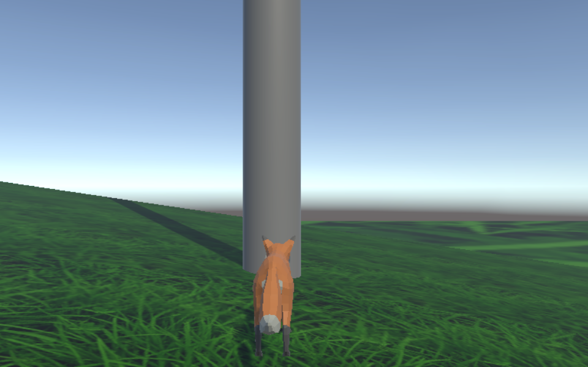

# First Unity Project

**A physics movement sandbox, and the first game project I've ever built.**



**[▶ Play in your browser](https://loganjjsmith.github.io/first-unity-project/)** · keyboard and mouse ·
desktop browser recommended

A small third-person sandbox in Unity 6: walk up to a pole and climb it, ride along the wires strung
between poles, slingshot yourself off a wire, flop as a ragdoll, and get back on your feet. It is a
proof of concept: one scene, a stand-in character, and the movement systems working together.

I'm a Java developer with no game-development background. I built this to learn Unity, and to learn how
to work well with AI coding agents. I directed the project and made the design calls, did the Unity
Editor work, wrote some of the code, and playtested everything. The agents (Grok, then Claude Code)
wrote most of the code. **[AI-WORKFLOW.md](AI-WORKFLOW.md)** gives the honest breakdown of who did what,
the rules I set for the agents, and the mistakes they made along the way.

## Controls

| Where | Input | Action |
|---|---|---|
| Anywhere | WASD / mouse | Move / look |
| | Shift | Sprint |
| | Space | Jump |
| | R | Respawn |
| Next to a pole | Hold W | Grab the pole and climb |
| On a pole | W / S | Climb up / down |
| | A / D | Circle around the pole |
| | Space | Kick off, in the direction of the camera |
| On top of a pole | Mouse | Turn |
| | Space | Leap the way you are facing |
| | W | Take the wire the camera points along |
| | S | Climb back down |
| In the air, near a wire | — | Grabbed automatically |
| On a wire | W / S | Travel along it, relative to the camera |
| | Space | Drop off |
| | Hold X or C, release | Pull back and slingshot (X: flung as a ragdoll, C: a controlled launch) |
| | Q (while pulling) | Lock the aim |
| In the air | WASD | Steer gently |

Test shortcuts: **1** teleports to the test spot, **Z** goes limp as a ragdoll from anywhere.

## How it was built

- **Package first, custom code last.** Anything that's a solved problem comes from Unity packages: the
  third-person controller (Starter Assets), the camera (Cinemachine), the wires (Splines), and the paws
  gripping the pole while climbing (Animation Rigging). Custom code covers what's specific to this
  project: climbing, wire riding, the slingshot, and ragdoll recovery.
- **Testable core.** The rules and maths (the mode state machine, lockouts, slingshot energy, climb
  gait, wire bending, ragdoll recovery) live in a separate assembly with no scene access, covered by
  248 NUnit tests. The MonoBehaviours connect that logic to the scene.
- **Robot tests for behaviour.** 14 Play-mode tests load the real scene and play it with a virtual
  keyboard: climb a pole, ride a wire to the far pole, slingshot both ways, go limp and recover. Key
  presses travel the same input path a player's do.
- **Two AI agents, and rules for both.** The project began with Grok and moved to Claude Code. The rules
  that kept the agents useful came from things going wrong: options before code, a three-attempt limit on
  any one bug, and "reproduce it before fixing it". Real examples of what the AI got wrong and how it was
  caught are in [AI-WORKFLOW.md](AI-WORKFLOW.md#what-the-ai-got-wrong-and-how-it-was-caught):
  - Grok built everything custom until the player controller was a single 91 KB script, which led to
    a package-first rebuild.
  - Grok broke working camera, movement and launch features while iterating on the ragdoll, which led
    to the three-attempt rule.
  - Claude Code made four wrong diagnoses of a camera bug before a frame-by-frame trace in the running
    Editor found the real cause in its own code.
  - Claude Code taught me Unity steps from an older version than the one I had installed.
  - Claude Code's robot tests only passed thanks to an unrelated package relaxing an input-focus
    rule. That surfaced while preparing this repo, and a two-line test fix replaced the accident.

## Tech

| | |
|---|---|
| Engine | Unity **6000.5.3f1** (Unity 6), Universal Render Pipeline 17.5 |
| Language | C# |
| Packages | Input System 1.19, Cinemachine 3.1.7, Splines 2.9.1, Animation Rigging 1.4.1, ProBuilder 6.1.2, Test Framework 1.7 |
| Third party | Unity Starter Assets (third-person controller; *not included*, see setup), Quaternius fox model (CC0) |
| Web build | WebGL 2, Gzip with Unity's decompression fallback, so it runs on a plain static host. A custom page template puts the controls to the left of the game and "things to try" to the right |

## Project layout

| Folder | What is in it |
|---|---|
| `Assets/Scripts/Mechanics` | Pure logic: the mode state machine, lockouts, movement, slingshot and ragdoll-recovery maths. No scene access, so all of it is unit-tested. |
| `Assets/Scripts/Identity` | MonoBehaviours that connect that logic to the scene: modes, pole climbing, wire riding, slingshot, ragdoll, camera tilt. |
| `Assets/Scripts/Dev`, `Environment` | Test shortcuts, and scene markers such as the respawn point. |
| `Assets/Tests/EditMode` | NUnit tests for everything in `Mechanics`. |
| `Assets/Tests/PlayMode` | Robot tests: the real scene, played with a virtual keyboard and mouse. |
| `Assets/Editor` | The command-line web build. |
| `Assets/WebGLTemplates/Sandbox` | The browser page: Unity's default template plus the controls and goals panels. |
| `Assets/Prefabs`, `Scenes`, `Art`, `Settings` | The player, the sandbox scene, the fox and grass, render and input settings. |
| `patches/` | This project's changes to the Starter Assets controller (see setup). |
| `tools/` | An offline C# typecheck and a git hook from the AI workflow. |
| `.claude/` | The guardrails and skills the AI agent worked under (see [AI-WORKFLOW.md](AI-WORKFLOW.md)). |

## Running it from source

Unity's Starter Assets cannot be redistributed in a public repository, so they are not in this one. You
import them yourself (they are free), then apply this project's changes as a patch. It's the same idea
as declaring a dependency and overriding part of it.

1. Install **Unity 6000.5.3f1** through Unity Hub, with **Web Build Support** if you want to build
   for the browser.
2. Clone this repository. In Unity Hub, choose **Add → Add project from disk** and select the folder.
3. Unity reports compile errors on first open, because the Starter Assets are missing, and offers
   Safe Mode. Choose **Ignore**.
4. Add Unity's free **Starter Assets** character controllers to your account on the Asset Store, then
   import them through **Window → Package Manager → My Assets**. Keep the project's own package
   versions if Unity asks.
5. From the repository root, apply the patch:
   ```sh
   git apply patches/ThirdPersonController.patch
   ```
6. Open `Assets/Scenes/Sandbox.unity` and press **Play**.

The patch was made against the `ThirdPersonController.cs` currently shipped in that package. The
`Assets/Starter Assets/` folder is gitignored, so the imported files never end up in a commit.

**Tests:** **Window → General → Test Runner**, then **Run All** on the EditMode and PlayMode tabs. Or
headless, with the Editor closed:

```sh
Unity -batchmode -nographics -projectPath . -runTests -testPlatform EditMode -testResults editmode.xml
Unity -batchmode -nographics -projectPath . -runTests -testPlatform PlayMode -testResults playmode.xml
```

**Web build:**

```sh
Unity -batchmode -quit -projectPath . -buildTarget WebGL -executeMethod WebBuild.Build -buildOutput Builds/Web
```

## Known limitations

- It's a proof of concept: one test scene, a stand-in fox model, and feel tuned to "reasonable", not
  polished.
- Keyboard and mouse only. The browser build is meant for desktop browsers.
- The world is scaled up (1 unit = 25 cm, gravity −80) for the movement feel, so the physics numbers
  in the code look large.
- Some URP features (FSR upscaling and one light-cookie format) aren't available on WebGL, and Unity
  falls back automatically. You'll see warnings about it in the browser console.

## Credits and licence

Third-party assets and attributions are listed in **[CREDITS.md](CREDITS.md)**.

Source visible for portfolio review; all rights reserved.
